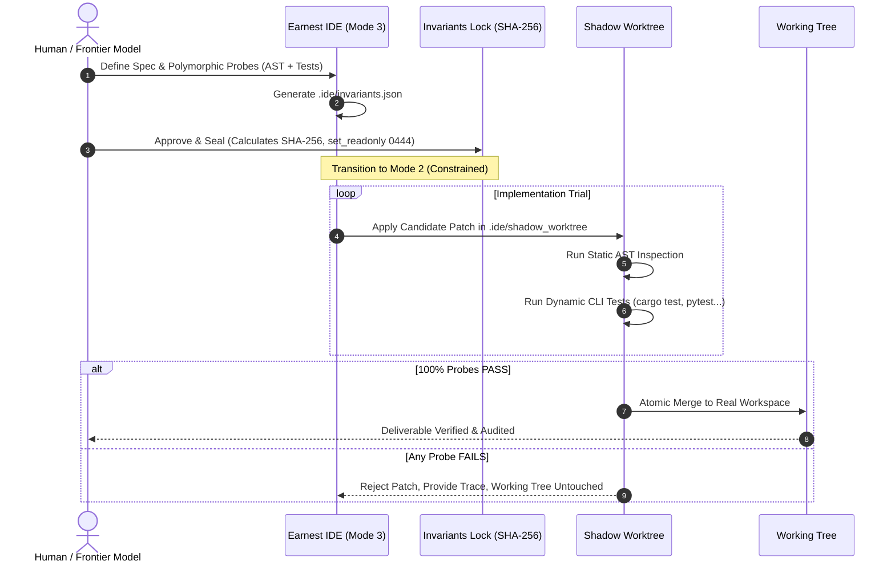

# EARNEST

<p align="center">
  <strong>E</strong>xperience-driven <strong>A</strong>gentic <strong>R</strong>untime & <strong>N</strong>ested <strong>E</strong>ngineering with <strong>S</strong>ealed <strong>T</strong>ruths
</p>

<p align="center">
  <em>The Verifiable Agentic IDE & Operating System: Spec-First Governance, Cryptographically Sealed Invariants, and Shadow Worktree Arbitration.</em>
</p>

<p align="center">
  
  
  
  
  
  
</p>

---

## 💡 The Core Problem: Why Agentic Coding Breaks

Modern AI coding agents (Copilot, Cursor, autonomous CLI agents) suffer from a fundamental flaw: **stochastic drift and uncontrolled file mutation**. 

When an LLM writes code directly to your working tree:
1. It modifies files without mathematical guarantees.
2. It breaks existing edge cases and silently alters interfaces.
3. It self-validates through shallow confirmations without formal contract verification.

**EARNEST changes the paradigm:** An agent should **never** write directly to the working tree. Instead, software evolution must follow a **formal proof cycle** backed by cryptographic invariants and isolated git worktrees.

---

## 🏛️ Architecture: The EARNEST Triad

EARNEST is composed of three self-reinforcing, modular pillars:

```
                  ┌────────────────────────────────────────┐
                  │           EARNEST ECOSYSTEM            │
                  └──────────────────┬─────────────────────┘
                                     │
         ┌───────────────────────────┼───────────────────────────┐
         │                           │                           │
         ▼                           ▼                           ▼
┌──────────────────┐       ┌──────────────────┐       ┌──────────────────┐
│   EARNEST IDE    │◄─────►│   EARNEST CORE   │◄─────►│   EARNEST BCPE   │
│ (Governance UI)  │  MCP  │ (Agent Runtime)  │  RAG  │ (Experience KB)  │
└──────────────────┘       └──────────────────┘       └──────────────────┘
         │                           │                           │
  - Spec-First / Modes        - Moteur ReAct              - Retours d'essais
  - Invariants scellés        - Shadow Worktree           - Heuristiques / Fixes
  - Interrupteur Humain       - Arbitre cryptographique   - Anti-répétition d'erreurs
```

### 1. 🛡️ EARNEST IDE (`earnest-ide`)
A specialized desktop & web cockpit for agentic governance:
- **Spec-First Lifecycle**: Enforces an explicit transition from **Mode 3 (Architecture & Invariants)** to **Mode 2 (Constrained Implementation)** and **Mode 1 (Unrestricted / Human)**.
- **Cryptographic Invariants Seal**: Invariants are hashed (`SHA-256`) and locked into `.ide/invariants.lock` with read-only OS permissions (`0o444`). Neither the agent nor unauthorized processes can mutate the contract without explicit human sign-off.
- **Shadow Worktree Arbitration**: Candidate code is patched and executed inside an isolated git worktree (`.ide/shadow_worktree`). Only when **100% of polymorphic probes (Static AST + Dynamic CLI tests)** PASS is the patch atomically merged into the working tree.

### 2. ⚡ EARNEST Core & OS (`earnest-core` / `earnest`)
The sovereign agentic execution engine:
- **MCP-Native (Model Context Protocol)**: Exposes 14+ standardized tools over stdio/HTTP (`earnest-ide-core --mcp --workspace <path>`), enabling any Frontier model (Claude, GPT, Gemini) to act as architect while delegating execution to local, specialized models.
- **ReAct Execution Engine**: Fast native loop with strict token accounting, tool registration persistence, and OS scheduler delegation (no rogue background daemons).
- **Zero-Build Vanilla UI**: Ultra-lightweight Web components + Monaco Editor powered by Tauri v2.

### 3. 🧠 EARNEST BCPE (`earnest-bcpe`)
The Experience-driven Knowledge Base:
- **Continuous Learning from Trials**: Stores incidents, failure modes, and successful probe templates into an embedded SQLite/RAG store.
- **Anti-Looping & Memory Recall**: During Mode 3 design, the agent queries (`kb_search`) previous real-world incidents to avoid reproducing known architectural mistakes.

---

## 🔄 The 4-Stage Governance Workflow



---

## 🚀 Quick Start

### Prerequisites
- **Rust**: `1.80+` (edition 2021/2024, `cargo`)
- **Python**: `3.11+` (`pytest` for agent tests)
- **Git**: Installed and accessible in your `PATH`

### 1. Clone the repository
```bash
git clone https://github.com/lecyberbill/Ernest.git
cd Ernest
```

### 2. Validate Cockpit & Core Invariants
Prove that all 10 architectural invariants are strictly respected:
```bash
python tests/validate_invariants.py
```
```text
=== Validation de 10 Invariants ===
[INV-01-SCHEMA-SQLITE] ... OK [PASS]
[INV-02-NO-DAEMON] ... OK [PASS]
[INV-03-CORE-TOOLS-SCHEMA] ... OK [PASS]
[INV-04-STORE-RECALL-MEMORY-ISOLATION] ... OK [PASS]
[INV-05-SANDBOX-EXECUTION] ... OK [PASS]
[INV-06-REGISTER-TOOL-PERSISTENCE] ... OK [PASS]
[INV-07-EXPLICIT-FAILURE] ... OK [PASS]
[INV-08-NO-UNAUTHORIZED-EXTERNAL-PROCESS] ... OK [PASS]
[INV-09-ZERO-BUILD-VANILLA-UI] ... OK [PASS]
[INV-10-OS-SCHEDULER-DELEGATION] ... OK [PASS]

TOUS LES 10 INVARIANTS SONT RESPECTES A 100% !
```

### 3. Run Unit Tests
```bash
pytest tests/
```

### 4. Build and Run EARNEST IDE Core (MCP Server)
```bash
cd earnest-ide/core
cargo run --release -- --mcp --workspace /path/to/project
```

### 5. Plug EARNEST into Claude Desktop / Antigravity / Any MCP Client
Add EARNEST to your MCP client configuration (`claude_desktop_config.json` or `mcp_config.json`):
```json
{
  "mcpServers": {
    "earnest-ide": {
      "command": "/path/to/Ernest/earnest-ide/core/target/release/earnest-ide-core.exe",
      "args": ["--mcp", "--workspace", "/path/to/your/project"]
    }
  }
}
```

---

## 📂 Repository Structure

```text
Ernest/
├── earnest/                    # Python Core: Agent runtime, tools, DB & telemetry
├── earnest-core/               # Rust Native Engine: High performance ReAct loop & server
├── earnest-ide/                # Governance IDE
│   ├── core/                   # Rust backend: MCP server, Shadow Worktree, Invariants
│   ├── src-tauri/              # Desktop wrapper (Tauri v2)
│   └── ui/                     # Vanilla JS + Monaco Editor UI cockpit
├── earnest-bcpe/               # Experience Knowledge Base (RAG & Incident Memory)
├── tests/                      # Formal test suites & Invariant verification harness
├── .ide/                       # Project-level governance policy & invariant definitions
└── invariants.json             # Core invariant specifications
```

---

## 🔒 Security & Verification Guarantees

- **Tamper-Proof Invariants**: Changes to `.ide/invariants.json` invalidate the SHA-256 seal stored in `.ide/invariants.lock`, immediately halting write permissions until re-approved.
- **Zero-Pollution Sandbox**: The main working tree is never touched during trial cycles; build artifacts and failures remain isolated in detached worktrees.
- **Local Sovereignty**: Sensitive credentials and keys use local OS-level encryption (Windows DPAPI / local secrets). No proprietary vendor lock-in.

---

## 📄 License

Dual-licensed under either of:
- [Apache License, Version 2.0](LICENSE-APACHE)
- [MIT License](LICENSE-MIT)

at your option.
